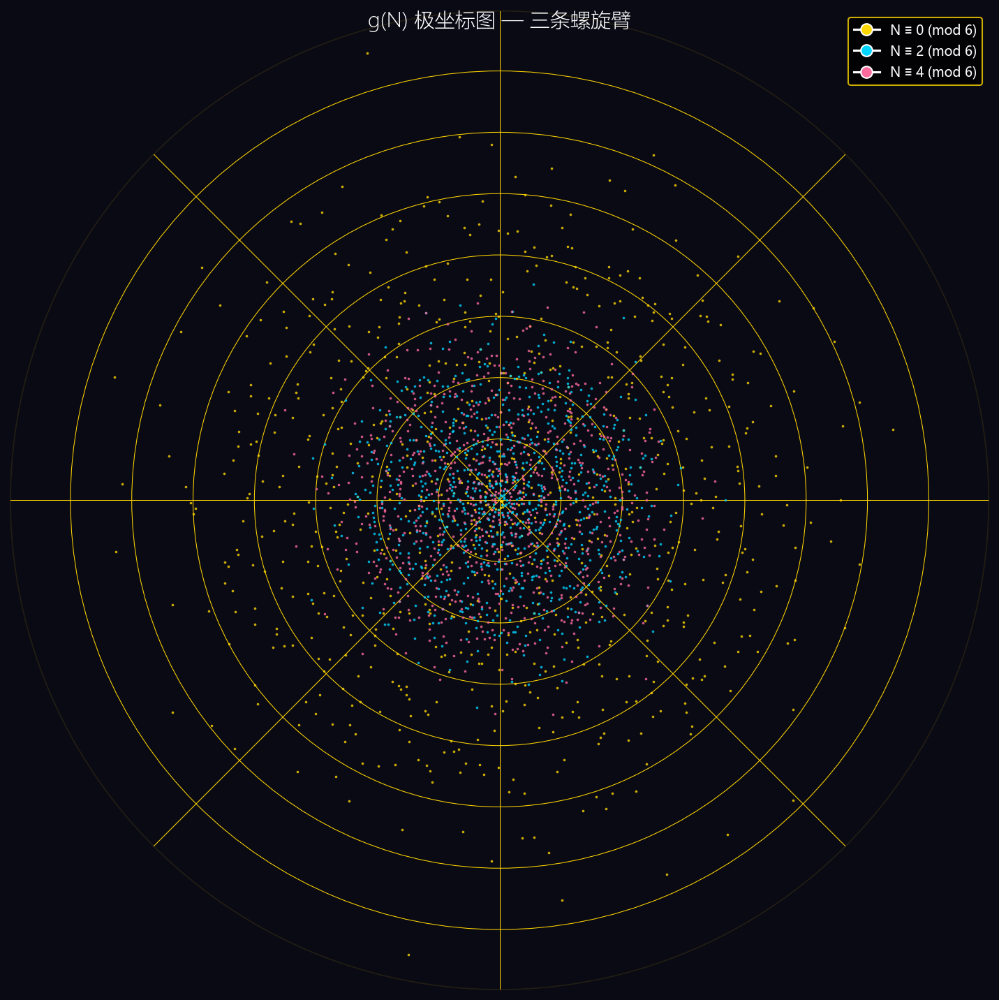
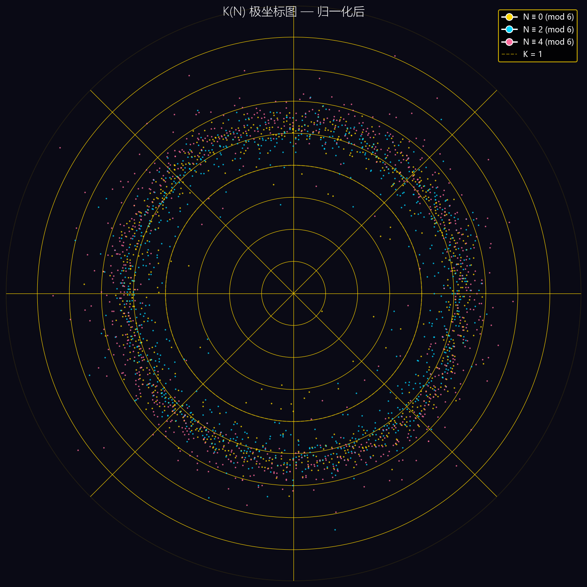
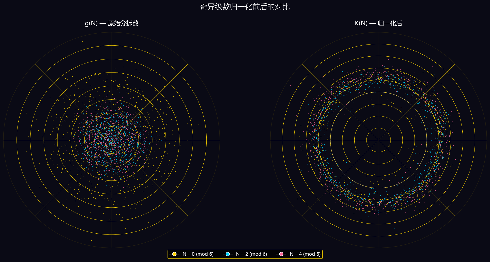

【金翼计划】旋转的素数对：用极坐标可视化哥德巴赫分拆数

🔬 金翼计划 · 耦合刚性研究
用大规模数值实验探索数论中的统计规律
完整版报告：https://luinstein.github.io/goldwing-research/paper/goldwing_v1.7_subpoisson.html
交互式可视化：https://luinstein.github.io/goldwing-research/visualizations/goldbach_polar.html

---

## 一、从"旋转的素数"说起

如果你刷过抖音或 B 站的数学科普，大概率见过一个很震撼的画面：把素数放到极坐标里，居然会形成漂亮的螺旋臂，像星系，像太阳花，像某种神秘的曼陀罗图案。

很多人看完会惊呼："素数居然有这么美的规律！"

但如果你稍微了解一点数论就会知道——这个现象虽然好看，原理其实很简单。素数（除了 2 和 3）一定是 6k±1 的形式，放到极坐标里自然就形成两条主要的臂。模的数越大，臂越多越细，但本质上就是**模运算的视觉化**。

那么——如果我们放的不是素数本身，而是**哥德巴赫分拆数**呢？

就是说，对于每个偶数 N，我们知道它可以写成多少种两个素数之和的形式（记为 g(N)）。如果把 N 当作角度、g(N) 当作半径，画到极坐标里，会看到什么？

这篇文章就来做这件事。而且我们会发现——哥德巴赫的螺旋，比素数螺旋有意思得多。

---

## 二、先搞清楚：g(N) 是什么？

哥德巴赫猜想说：**每个大于 2 的偶数都可以写成两个素数之和。**

比如：
- 6 = 3 + 3 → 1 种
- 8 = 3 + 5 → 1 种
- 10 = 3 + 7 = 5 + 5 → 2 种
- 12 = 5 + 7 → 1 种
- 14 = 3 + 11 = 7 + 7 → 2 种
- 16 = 3 + 13 = 5 + 11 → 2 种
- ……

我们把"有多少种写法"记为 g(N)，叫做**哥德巴赫分拆数**。

直觉上，N 越大，素数越多，能配对的组合也越多，所以 g(N) 应该越来越大。这没错——但如果你把 g(N) 画出来，会发现它不是一条平滑上升的线，而是**锯齿状的、剧烈波动的**。

有的偶数分拆数特别多，有的特别少。为什么？

---

## 三、极坐标下的 g(N)：三条螺旋臂

我们来做个实验：

> 在极坐标里，对每个偶数 N：
> - 角度 θ = N（弧度）
> - 半径 r = g(N)
> - 画一个点

也就是说，偶数 6 在 6 弧度的位置、距离圆心 g(6)=1；偶数 8 在 8 弧度的位置、距离 g(8)=1……以此类推。

画出来是什么样的？

看到了吗？**三条清晰的螺旋臂**。

为什么是三条？因为偶数模 6 只有三种可能的余数：0、2、4。对应的三条臂强度还不一样——

- **金色的臂（N ≡ 0 mod 6）**：最靠外，g(N) 最大
- **青色的臂（N ≡ 2 mod 6）**：中间
- **粉色的臂（N ≡ 4 mod 6）**：跟青色差不多

数一数：金色那条臂上的点，到中心的距离大约是另外两条的 **2 倍**。

---

## 四、为什么是 2 倍？——奇异级数的魔力

这个 2 倍关系，不是巧合。它来自数论里一个非常深刻的公式——**Hardy-Littlewood 哥德巴赫猜想**。

1923 年，哈代和李特尔伍德提出了一个猜想：

> 对于大偶数 N，哥德巴赫分拆数的渐近公式是：
> 
> **g(N) ~ S(N) · N / ln²N**
> 
> 其中 S(N) 叫做**奇异级数**（singular series），定义为：
> 
> S(N) = C₂ · ∏_{p|N, p>2} (p-1)/(p-2)
> 
> C₂ ≈ 0.66016，叫做孪生素数常数。

这个公式看起来很复杂，但核心意思很简单：

**g(N) 的大小，主要由 N 的素因子决定。**

特别是——**如果 3 是 N 的素因子，S(N) 就会乘以 (3-1)/(3-2) = 2。**

而 N ≡ 0 mod 6 的偶数，正好都能被 3 整除。所以它们的 g(N) 大约是另外两类偶数的 2 倍。

就这么简单。

我们用实际数据验证一下（N ≤ 5000）：

| 剩余类 | g(N) 均值 |
|--------|----------|
| N ≡ 0 mod 6 | ~ 78.5 |
| N ≡ 2 mod 6 | ~ 38.5 |
| N ≡ 4 mod 6 | ~ 39.8 |
| **比值 0/2** | **2.04** |

实际比值 2.04，理论值 2.0，非常接近。（差的那一点点，是因为 N 还不够大，以及 N 还有其他素因子的影响。）

这就是极坐标里三条臂的来源——**奇异级数 S(N) 的可视化**。

---

## 五、归一化之后：K(N) 的世界

既然 g(N) 的差异主要是由 N 的素因子结构导致的，那如果我们把这个结构因素"除掉"，剩下的是什么？

我们定义一个归一化的量：

> **K(N) = g(N) · ln²N / (S(N) · N)**

简单说，就是用 Hardy-Littlewood 公式把 g(N) 除一下，看看剩下的东西。

如果 H-L 猜想完全成立，那么 K(N) 应该等于 1。

当然，实际情况不会这么完美——g(N) 是有涨落的。但 K(N) 应该**围绕 1 上下波动**。

我们把 K(N) 也画到极坐标里看看：

发现了吗？三条臂**靠拢了**，形成了一个大致均匀的环，半径差不多都是 1。

这说明什么？

说明奇异级数 S(N) 确实抓住了 g(N) 的**主要结构差异**。把它除掉之后，不同剩余类的偶数就"站到了同一起跑线上"。

这就是 K(N) 的意义——**它是消除了结构差异之后，真正的"涨落"。**

我们来张对比图，效果更直观：

左边是原始的 g(N)，三条臂分得很开；右边是归一化后的 K(N)，所有点聚拢成一个环。

---

## 六、这才是真正有意思的地方

到目前为止，我们看到的都是"意料之中"的事——模 6 有三条臂，奇异级数解释了差异，归一化之后就均匀了。

这些都很经典，不新鲜。

**真正新鲜的，是 K(N) 的涨落本身。**

如果 K(N) 只是围绕 1 的随机涨落，那也没什么。但我们的研究（金翼计划）发现了几个非常反直觉的现象：

### 现象 1：亚泊松涨落

如果 g(N) 的涨落完全是随机的（像泊松过程一样），那么方差应该等于均值。但实际情况呢？

**K(N) 的方差，比"应该有的"小得多。**

量化一下：Fano 因子 F = Var(K) / ⟨K⟩ ≈ 0.30。

也就是说，涨落只有泊松水平的 30%。分拆数比你想象的"安静"得多。

为什么？因为**相邻偶数之间共享素数对，它们的涨落是互相抵消的**。一个偶数分拆数高了，旁边的偶数就会低一点——就像弹簧一样，互相拉扯，整体就稳定了。

我们把这个叫做**耦合刚性**（coupling rigidity）。

### 现象 2：漂移律

K(N) 的均值不是常数，而是随着 N 慢慢变化的。看起来像是在"漂移"。

但最神奇的是——**这个漂移可以从零参数精确导出**：

> ⟨K(N)⟩ ≈ 2 · Φ(1 / ln N)
> 
> 其中 Φ 是标准正态分布的 CDF。

不需要拟合，不需要调参数，从基本原理就能算出来。

而且算出来的值，跟数值实验的结果，偏差不到 0.01。

### 现象 3：β(y) 耦合函数

我们定义了一个量 β(y)，表示"距离为 y 的两个偶数，它们的 K 值偏差有多大的相关性"。

就像在极坐标里，相邻的点颜色相近（因为它们共享素数对），隔得远的点颜色就没关系了。

β(y) 描述了这种相关性随距离衰减的规律。而且我们发现——**这个函数可能是普适的**，跟 N 的大小关系不大。

---

## 七、从一张图到一个研究计划

一张漂亮的图，只是起点。

哥德巴赫分拆数的极坐标可视化，最开始只是一个"觉得可能好看"的小实验。但画出来之后，我们看到的不只是美——

- 三条臂的强度比 → 指向奇异级数
- 归一化后的环 → 指向 K(N) 的收敛性
- 环的厚度 → 指向涨落的大小（亚泊松）
- 环上的"纹理" → 指向耦合函数 β(y)

**每一个视觉特征，背后都对应着一个数学问题。**

金翼计划就是这样开始的——从一个可视化，到一堆问题，再到一个系统性的研究。我们用大规模数值实验，一点一点丈量这个我们还没法证明的世界。

目前我们已经有了一些初步发现：亚泊松涨落、零参数漂移律、耦合刚性框架、β(y) 普适性猜想……但还有更多开放问题在等着。

如果你感兴趣，可以去看我们的完整报告，或者直接上手玩这个可视化工具。

---

## 八、自己动手玩

我们做了一个交互式的网页工具，你可以：

- 切换 g(N) / K(N) 模式
- 调节最大偶数（200 ~ 20000）
- 切换着色方案（按模 6 / 按偏差 / 按密度）
- 鼠标悬停看每个点的详细数据
- 缩放、拖拽、旋转动画

👉 **点这里直接玩交互式可视化**
https://luinstein.github.io/goldwing-research/visualizations/goldbach_polar.html

源代码也都在 GitHub 上，欢迎 Star、Fork、提 Issue。

---

## 写在最后

数学的美，有时候藏在公式里，有时候藏在图像里。

极坐标下的哥德巴赫分拆数，第一眼看到的是三条彩色的螺旋臂——很美。但再往深看，你会发现奇异级数的结构、耦合刚性的痕迹、漂移律的影子……

美只是第一层。第二层，是规律。第三层，是为什么会有这样的规律。

我们还在第三层摸索。

如果你也对这些问题感兴趣，欢迎一起探索。

---

🔬 金翼计划 · 耦合刚性研究
📖 完整报告：https://luinstein.github.io/goldwing-research/paper/goldwing_v1.7_subpoisson.html
💻 GitHub 仓库：https://github.com/luinstein/goldwing-research
✨ 交互式可视化：https://luinstein.github.io/goldwing-research/visualizations/goldbach_polar.html
