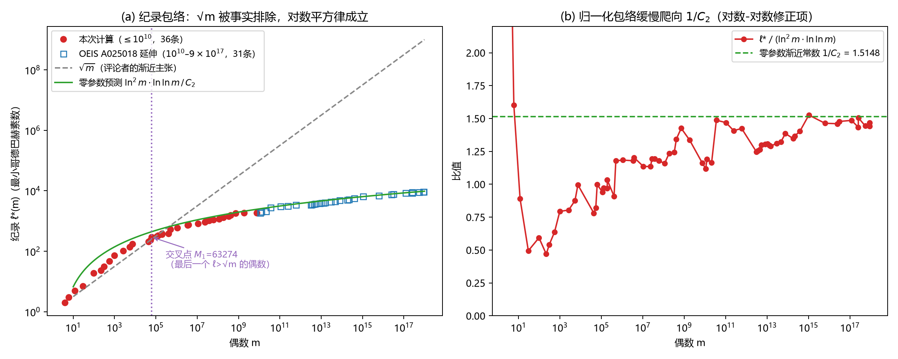
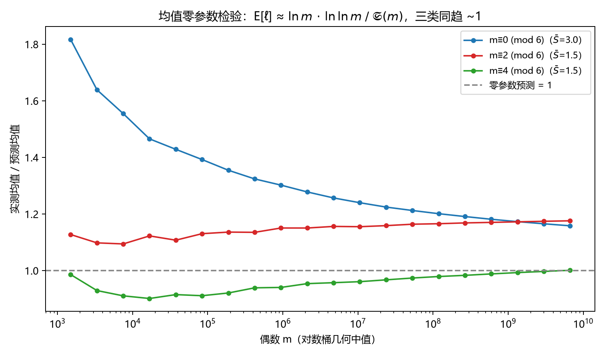
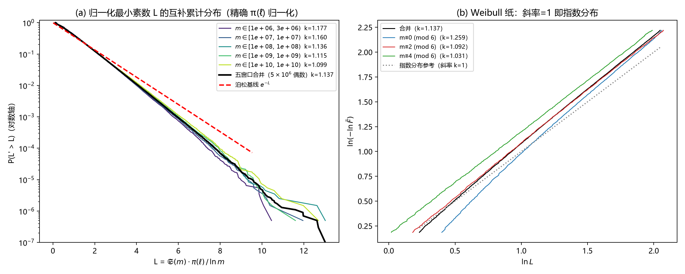
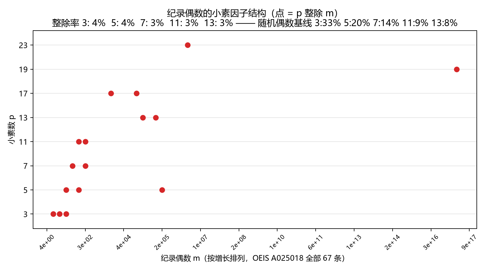

【金翼计划】最难配对的偶数：一条读者评论引出的 50 亿次检验

🔬 金翼计划 · 最小哥德巴赫素数研究
用大规模数值实验探索数论中的统计规律
开源仓库：https://github.com/luinstein/goldwing-research

---

## 一、一条读者评论

本系列的亚泊松涨落文章发出后，有读者在评论区提出了一个非常具体的猜想：

> "离偶数 2N 最近的素数对，最大距离不超过 8√(2N)，渐近意义下不超过 √(2N)。"

这个猜想翻译成数论语言，是这样一个量：

> **ℓ(m) = 最小的素数 p，使得 m − p 也是素数。**

也就是偶数 m 的所有哥德巴赫分拆中，**最贴着端点**那一对的内端点。ℓ(m) 越小，说明 m 越好配对；ℓ(m) 越大，说明这个偶数"很难缠"。

这个序列不是新东西——它在 OEIS 里是 **A020481**；那些"创新高"的纪录偶数（即 ℓ(m) 比之前所有偶数都大的 m）收在 **A025018**，对应的纪录值收在 **A025019**，数据源自 Tomás Oliveira e Silva 的哥德巴赫大验证。

但评论者的**定量主张**——ℓ 最大能长到 √m 量级——是对是错？这需要数据回答。

于是我们做了两轮实验。

---

## 二、实验 1：把 50 亿个偶数全部扫一遍

第一轮：从 4 到 10¹⁰（一百亿），**全部 50 亿个偶数**，逐个算出 ℓ(m)。服务器分段筛跑了 111.8 分钟。

结果一句话：

> **50 亿个偶数，零反例；36 条纪录，与 OEIS A025018/A025019 逐项一致。**

最后一条纪录是 m = 7,473,202,036，ℓ = 1877。也就是说，一百亿以内"最难配对"的偶数，也只用到 1877 这个素数就配上了。

那 √m 呢？10¹⁰ 的平方根是 100,000。1877 离 100,000 差着 **53 倍**。

更细致地看：

- 违反 ℓ > √m 的偶数**总共只有 73 个**，最后一个出现在 m = 63,274。我们把这个位置称为**交叉点 M₁**——过了它，√m 界就再也没有被碰过。
- 评论者的宽松版 8√m 界：整个扫描中利用率最高的一刻是 m = 992，ℓ = 73，用了界的 **28.97%**。这个界始终是真实值的 3.45 倍以上，而且越来越松。

**结论一：√(2N) 量级的渐近主张，在 10¹⁰ 以内被数据明确排除，而且差距在持续拉大。**

---

## 三、真正的包络：对数平方律

那 ℓ 到底长多快？把纪录值画成图（红点是我们的 36 条，蓝框是 OEIS 延伸到 9×10¹⁷ 的 31 条）：

左图里灰色虚线是 √m——它一飞冲天，而纪录值远远躺在下面。绿色实线是我们给出的**零参数**预测（没有任何拟合成分）：

> **ℓ*(N) ≈ ln²N · ln ln N / C₂**

其中 C₂ ≈ 0.6602 是孪生素数常数。右图把纪录值除以 ln²m·ln ln m：比值从 10¹⁰ 处的 1.16 缓慢爬到 9×10¹⁷ 处的 1.47，正在逼近理论常数 1/C₂ = 1.5148。

这个公式从哪来？一句话版本：对每个偶数，依次试小素数就像一列独立抽签，中签率正比于 𝔖(m)/ln m（𝔖 是 Hardy–Littlewood 奇异级数）；等到"试过的素数个数 × 中签率 ≈ 1"时基本就配上了。取最大值时再乘一个 ln N 的极值因子，就是 ln²N·ln ln N。

**结论二：最难配对的偶数，其难度是对数平方级的——比平方根慢得多。√m 主张被排除，ln²m·ln ln m / C₂ 成立（数值精度已达 3%）。**

---

## 四、不仅是最难，平均也能算：零参数的均值公式

纪录是极端值。那普通偶数呢？我们给出的均值公式同样是零参数的：

> **E[ℓ(m)] ≈ ln m · ln ln m / 𝔖(m)**

𝔖(m) 是奇异级数——直观理解：m 的小素因子越多，越容易配对。可以解析证明它的类条件均值：6 的倍数类 𝔖̄ = 3，其余两类 𝔖̄ = 3/2。

数据怎么说？我们在 5 个十年窗口（10⁶ 到 10¹⁰，每窗 100 万个偶数）里实测：

- **𝔖 的类均值：理论 3 与 1.5，实测 2.999995 与 1.500000**——精确到小数点后 5 位；
- 均值公式主项在 10¹⁰ 处的残差：m≡0 类 +15.8%，m≡2 类 +17.6%，**m≡4 类仅 +0.1%**，且三条曲线从三个方向向 1 收敛：

还有一个意外发现：**m≡2 类比 m≡4 类系统性地难配对 17% 左右**。原因是同余封锁——m≡2 (mod 6) 时所有 p≡2 (mod 3) 的素数（5、11、17…）被自动排除，m≡4 (mod 6) 时被排除的是 p≡1 (mod 3)（7、13、19…）；而素数在这两个剩余类里的小尺度分布并不对称（数论里叫 **Chebyshev 偏置**，Rubinstein & Sarnak 1994, *Exp. Math.* 3(3):173–197）。一个 1853 年发现的素数分布偏置，竟然直接写进了每个偶数的"配对难度"里。

---

## 五、最深的一层：分布的形状

均值和极值之外，还有一个更细的问题：**ℓ 的完整分布是什么形状？**

如果素数真像泊松随机点那样"各自为战"，归一化量 L = 𝔖(m)·π(ℓ)/ln m（π 是素数计数）应当精确服从速率 1 的指数分布——尾巴按 e^(−L) 衰减。如果存在"耦合刚性"（本计划的核心猜想：素数之间有抑制涨落的结构协调），尾巴应该**比指数薄**。

500 万个偶数的实测：

- 五个十年窗口的 Weibull 形状参数 k = **1.18 / 1.16 / 1.14 / 1.12 / 1.10**，稳定地大于 1（k=1 是指数分布；k>1 意味着尾巴更薄、极端事件更少）；
- 按模 6 分层：m≡0 类 k = 1.26，m≡2 类 k = 1.09，m≡4 类 k = 1.03——**结构性越强（小素因子越多）的类，刚性越明显**。

一个诚实的插曲：我们最初用粗归一化 L₁ = ℓ·𝔖/(ln m·ln ln m)，算出 k ≈ 0.86（比指数还厚）——这是 π(x)≈x/ln x 近似的 ln ln 失真造成的假象。换成精确归一化 L₂ = 𝔖·π(ℓ)/ln m 后，信号才翻正为 k>1。**归一化方式本身会撒谎，这也是我们要报告的方法论教训。**

**结论三：在正确归一化下，最小哥德巴赫素数的分布尾部系统性地薄于泊松基线——这是"耦合刚性"在全新统计量上的又一次独立出现。**

---

## 六、纪录保持者的"指纹"

最后看一眼那些最难配对的偶数长什么样。把 OEIS 全部 67 条纪录偶数摊开，标出它们被哪些小素数整除：

触目惊心的干净：被 3 整除的只占 **4.5%**（随机偶数是 33%），被 5 整除的 4.5%（基线 20%），被 7、11、13 整除的各 3%。

**最难配对的偶数，就是那些什么小素因子都没有的偶数。** 直觉很直白：每多一个小素因子，奇异级数就多一分加成，小素数就更容易"一击命中"。难缠的偶数必须是"光滑的孤儿"。

---

## 七、老规矩：三分法归档

按本计划的铁律，诚实分级：

**① 经典（前人已证，我们接住）**
- ℓ(m) 序列本身：OEIS A020481；纪录表 A025018/A025019（Tomás Oliveira e Silva 的验证数据）；
- 奇异级数主项：Hardy & Littlewood 1923, *Acta Math.* 44:1–70；
- Chebyshev 偏置：Rubinstein & Sarnak 1994。

**② 复现 / 精细化（前人结论 + 我们的数值印证）**
- 独立复算 50 亿偶数，36 条纪录与 OEIS 逐项一致，零反例；
- 类条件均值 𝔖̄ = 3 与 3/2 的解析式，实测符合到 10⁻⁶ 量级；
- 交叉点 M₁ = 63,274 的精确定位。

**③ 候选新发现（检索未见，待确认，置信度中）**
- ℓ 分布的 Weibull 形状参数 k>1 及其模 6 分层结构（k = 1.26 / 1.09 / 1.03）——ℓ(m) 的完整极限分布在文献中我们没有查到；
- 配对难度的 Chebyshev 不对称（E[ℓ|m≡2]/E[ℓ|m≡4] ≈ 1.17）的定量形式；
- 包络常数收敛到 1/C₂ 的数值证据链。

**落点追问（这东西能干什么）：** ℓ*(N) 是"最坏情况"的鲁棒证书——任何依赖"大偶数必能快速分解"的编码、采样或密码构造，其安全性下界由它决定；而"尾部比泊松薄"若持续成立，意味着自然界的素数系统比独立随机模型更"守规矩"——极端风险的聚集被结构抑制，这正是我们把耦合刚性往金融风险语言翻译时最需要的一块砖。

---

## 八、数据与代码

- 实验 1 全部输出（纪录表、反例表、尺度统计）：`trae/exp1_boundary/run_1e10/`
- 实验 2/3 采样与分析脚本：`trae/exp1_boundary/exp3_dist.py`、`analyze_exp23.py`
- 仓库：https://github.com/luinstein/goldwing-research

**正在进行：** 扫描上界已推到 10¹¹（约 30 小时跑完）。按 OEIS，接下来应当撞上 4 条新纪录（ℓ = 1879、2029、2089、2803）——其中 ℓ = 2803 那条（m ≈ 3.6×10¹⁰）是一次大跳变，我们的包络公式预测它落在 ln²m·ln ln m/C₂ 附近。跑完即知。

---

*本系列其他文章：《哥德巴赫彗星的条纹》《亚泊松涨落》《七个开放问题》《旋转的素数对》*
